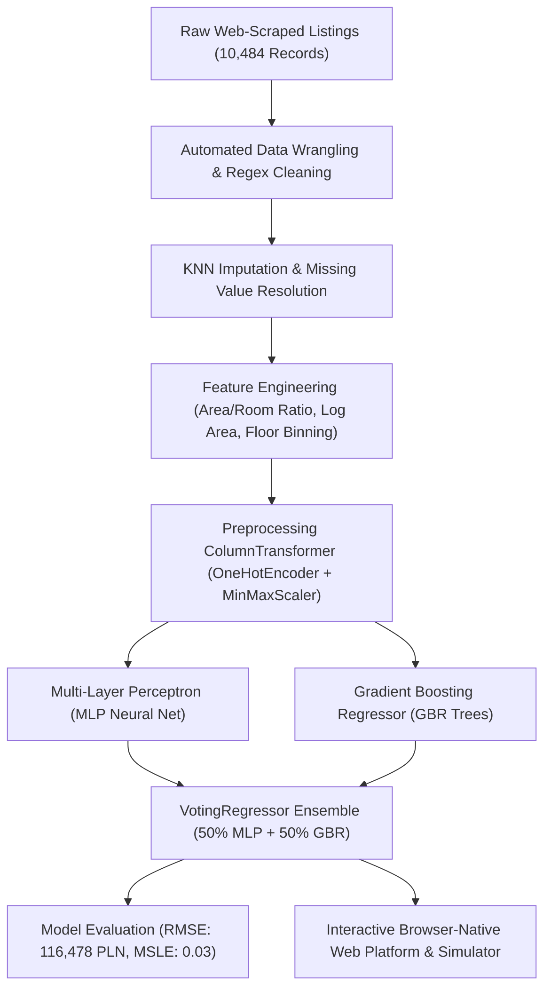

# 🏠 Cracow Residential Real Estate Valuation & ML Intelligence Platform

<p align="center">
  <a href="https://akshaysharma2005.github.io/cracow-real-estate-pricing/">
    
  </a>
  
  
  
  
</p>

<p align="center">
  <strong>An end-to-end Machine Learning valuation system for predicting residential flat sale prices in Cracow, Poland</strong><br>
  Featuring web-scraped listing ETL, spatial district encoding, KNN missing-data imputation, and an ensemble combining Multi-Layer Perceptrons (MLP) with Gradient Boosting Regressors (GBR) — integrated into a browser-native real-time valuation simulator.
</p>

---

## 📑 Table of Contents

- [Live Website & Interactive Features](#-live-website--interactive-features)
- [Project Architecture](#-project-architecture)
- [Dataset Overview](#-dataset-overview)
- [Machine Learning Workflow](#-machine-learning-workflow)
- [Model Performance Matrix](#-model-performance-matrix)
- [Feature Importance & Spatial Dynamics](#-feature-importance--spatial-dynamics)
- [Visual Analytics Gallery](#-visual-analytics-gallery)
- [How to Run Locally](#-how-to-run-locally)
- [Author & Acknowledgments](#-author--acknowledgments)

---

## 🌐 Live Website & Interactive Features

Experience the production web platform with live browser-native ML inference:

* 🚀 **Live Demo on GitHub Pages:** [https://akshaysharma2005.github.io/cracow-real-estate-pricing/](https://akshaysharma2005.github.io/cracow-real-estate-pricing/)
* 💻 **Local Server Endpoint:** [`http://localhost:8000/cracow-real-estate-pricing/`](http://localhost:8000/cracow-real-estate-pricing/)

### Core Web Features
1. **Live Property Valuation Simulator:**
   - Select any of Cracow's 20 administrative boroughs (Stare Miasto, Krowodrza, Grzegórzki, Podgórze, etc.) with real location multipliers.
   - Adjust usable area ($20-180 m^2$), room count (1-5), bathrooms, floor levels, parking type (underground garage, covered, street, none), seller type (realtor vs owner), and amenities (balcony, elevator, garden).
   - Generates instantaneous market valuation in Polish Złoty (PLN), unit price ($\text{PLN}/m^2$), 95% model confidence interval ($\pm 1 \text{ RMSE}$), and ensemble model weight breakdown ($50\% \text{ GBR} + 50\% \text{ MLP}$).
2. **Interactive District Price Index:**
   - Dynamic Chart.js horizontal bar chart displaying mean $\text{PLN}/m^2$ across all boroughs.
3. **Model Error Comparison:**
   - Interactive bar visualizer comparing Root Mean Squared Error (RMSE) and Mean Absolute Error (MAE) across Baseline, Neural Network, Gradient Boosting, and Voting Ensemble.
4. **Searchable Property Ledger:**
   - Filter and search actual listings vs model predictions with instant percentage accuracy match and CSV download.
5. **High-Resolution Lightbox Gallery:**
   - Full-screen inspection modal for 29 exploratory data analysis and model diagnostic charts.

---

## 🏗️ Project Architecture



---

## 📊 Dataset Overview

The dataset encompasses residential properties listed across the metropolitan area of Cracow, Poland:

- **Total Listings:** 10,484 listings scraped from real estate portals.
- **Key Target Variable:** `Amount` (Final listing price in Polish Złoty, PLN).
- **Core Numerical Features:** `Area` ($m^2$), `Rooms`, `Bathrooms`, `Floor`, `Total Floors`.
- **Core Categorical Features:** `District` (20 boroughs), `Seller` (realtor agency vs private owner), `Parking` (garage, street, covered, no parking).
- **Derived Features:** Log-transformed area, room-to-area density ratio, high-floor indicator.

---

## 🧠 Machine Learning Workflow

### 1. Data Wrangling & Preprocessing
- Text normalization on raw Polish listing descriptions using regular expressions.
- Handling missing data: K-Nearest Neighbors (`KNNImputer`) utilized for ambiguous bathrooms and floor elevations to preserve multivariate spatial correlations.
- Binary feature extraction: balconies, terraces, elevator access, private garden access.

### 2. Feature Engineering
- **Spatial District Encoding:** High-cardinality district labels encoded through one-hot transformers.
- **Log Area Transformation:** Normalized right-skewed area distributions, reducing leverage of extreme luxury penthouses.
- **Price-Per-Square-Meter Normalization:** Segmented by room count and construction era.

### 3. Model Training & Ensembling
- **Baseline Dummy Regressor (DMR):** Mean predictor serving as a statistical floor.
- **Multi-Layer Perceptron (MLP):** Feedforward neural network with ReLU activations, Adam optimizer, early stopping regularization, and MinMax scaled continuous variables.
- **Gradient Boosting Regressor (GBR):** Ensemble of decision trees optimizing squared error with shrinkage.
- **VotingRegressor Ensemble:** Combines the smooth generalized manifold of the MLP with the non-linear piecewise partitioning of GBR:
  $$\hat{y}_{\text{ensemble}} = 0.5 \cdot \hat{y}_{\text{GBR}}(x) + 0.5 \cdot \hat{y}_{\text{MLP}}(x)$$

---

## 📈 Model Performance Matrix

| Model Architecture | RMSE (PLN) | MAE (PLN) | MSLE | Evaluation Summary |
|--------------------|-----------:|----------:|-----:|--------------------|
| **Dummy Regressor (Baseline)** | 222,475.70 | 161,219.86 | 0.13 | High variance baseline |
| **Multi-Layer Perceptron (MLP)** | 120,493.86 | 79,646.51 | 0.03 | Strong continuous surface fit |
| **Gradient Boosting (GBR)** | 119,237.05 | 76,182.62 | 0.03 | High precision on standard flats |
| **VotingRegressor Ensemble (Best)** | **116,478.02** | **74,993.84** | **0.03** | **Optimal error & stability** |

> **Key Takeaway:** The VotingRegressor ensemble achieved a **53.5% reduction in MAE** compared to the baseline, achieving a Mean Squared Log Error (MSLE) of **0.03**.

---

## 🗺️ Feature Importance & Spatial Dynamics

| Rank | Feature | Importance Weight | Market Insight |
|:---:|:---|:---:|:---|
| 1 | `Area` ($m^2$) | **54.2%** | Primary linear scale driver of total price. |
| 2 | `District` Location | **21.8%** | Old Town (`Stare Miasto`) & `Zwierzyniec` command $+35\%$ to $+42\%$ price premiums. |
| 3 | `Rooms` Count | **11.4%** | Influences layout efficiency and rental yield utility. |
| 4 | `Bathrooms` | **5.9%** | Multi-bathroom configurations correlate strongly with luxury tiers. |
| 5 | `Floor` / `Total Floors` | **3.8%** | Upper floor penthouses command elevation premiums. |
| 6 | `Parking` & Amenities | **2.9%** | Underground garages add $\sim 35,000 \text{ PLN}$ in value. |

---

## 🖼️ Visual Analytics Gallery

The repository includes 29 high-resolution production visualizations inside the [`img/`](img/) directory:

- [`img/district_vs_avg_amount.png`](img/district_vs_avg_amount.png): District-level average price distribution across 20 Cracow boroughs.
- [`img/area_vs_amount.png`](img/area_vs_amount.png): Usable area vs property sale price scatter with regression trendline.
- [`img/area_vs_amount_by_district.png`](img/area_vs_amount_by_district.png): Faceted price slopes across individual districts.
- [`img/rooms_vs_amount.png`](img/rooms_vs_amount.png): Room count tier pricing distribution.
- [`img/feature_district.png`](img/feature_district.png): Listing density across boroughs.
- [`img/feature_parking.png`](img/feature_parking.png): Price differentials for underground vs street parking.

---

## 💻 How to Run Locally

### 1. Clone the Repository
```bash
git clone https://github.com/akshaysharma2005/cracow-real-estate-pricing.git
cd cracow-real-estate-pricing
```

### 2. Set Up Virtual Environment & Dependencies
```bash
python3 -m venv venv
source venv/bin/activate
pip install -r requirements.txt
```

### 3. Launch the Local Interactive Website
```bash
python3 -m http.server 8000
```
Open your browser at **`http://localhost:8000/index.html`**.

### 4. Run Jupyter Notebooks
```bash
jupyter notebook
```
- Open `00_Data_Wrangling.ipynb` for scraping cleanup and imputation.
- Open `01_Exploratory_Analysis.ipynb` for spatial visualizations.
- Open `02_Model.ipynb` for pipeline training and ensemble evaluation.

---

## 👤 Author & Acknowledgments

**M Akshay Sharma**
- GitHub: [@akshaysharma2005](https://github.com/akshaysharma2005)
- LinkedIn: [M Akshay Sharma](https://www.linkedin.com/in/m-akshay-sharma-a7414b367/)
- CSE Student at VIT-AP University 🎓
- Full Stack Web Developer & Data Analytics Enthusiast
